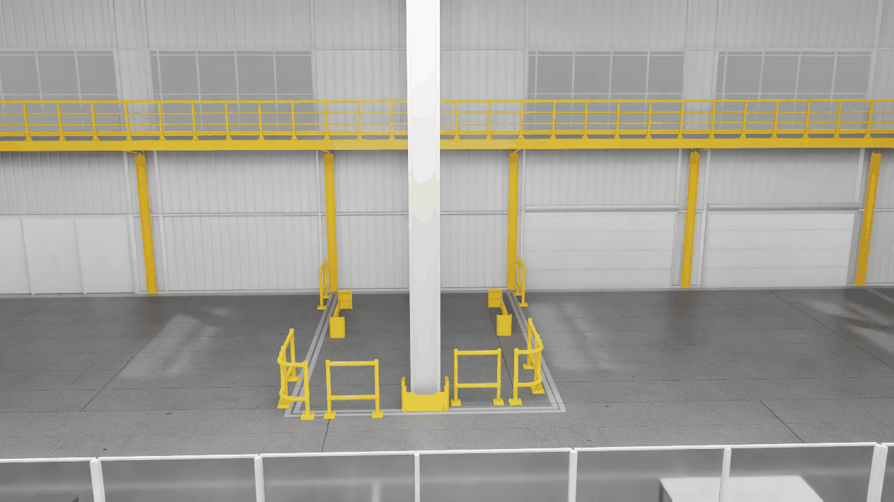
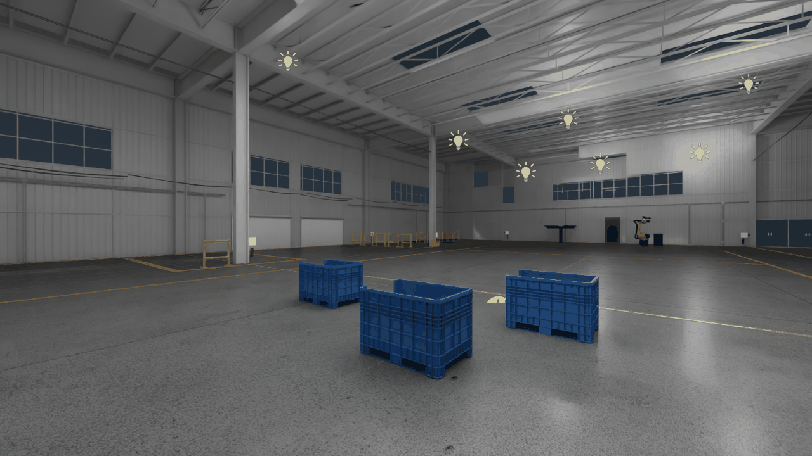
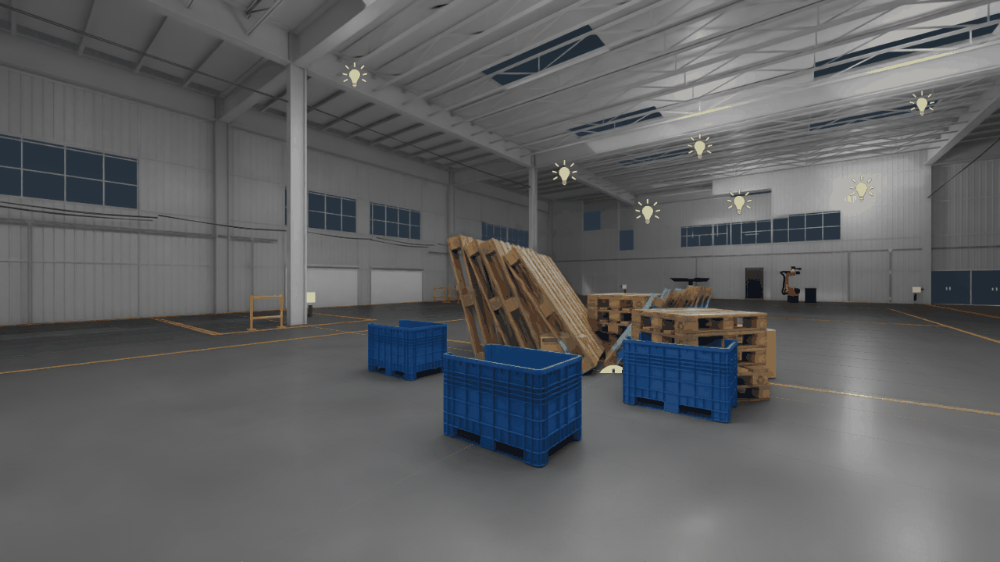
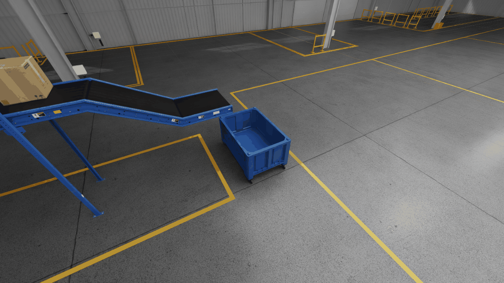
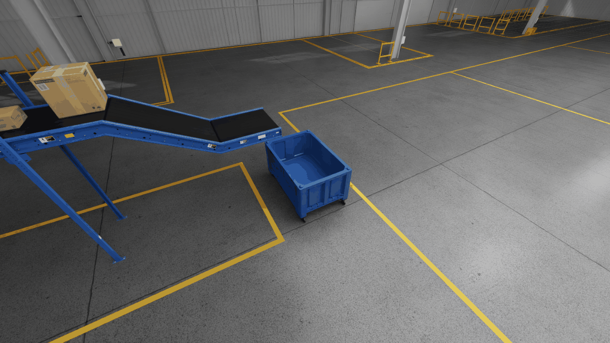
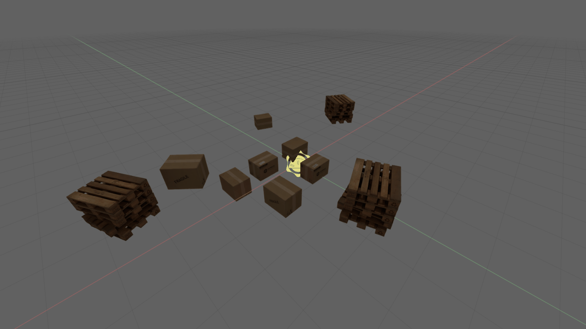

# Omniverse Kit Projects

Three sub-projects built while following the NVIDIA DLI courses
[Developing an Omniverse Kit-Based Application](https://learn.nvidia.com/courses/course-detail?course_id=course-v1:DLI+S-OV-11+V1),
Creating Omniverse Extensions with Python, and Extending Omniverse Kit Applications for Building Digital Twins.
Everything lives in `omniverse-kit-app-extensions/source/` and is built on the
[Kit App Template](https://github.com/NVIDIA-Omniverse/kit-app-template).

## Repository layout

| Path | Purpose |
|------|---------|
| `omniverse-kit-app-extensions/source/apps/` | Kit applications (`ellie.test_app`, `omnibase.editor`, `ellies.usd_explorer`, `ellies.usd_composer`) |
| `omniverse-kit-app-extensions/source/extensions/` | Python extensions (`ellies.python_ui_extension` and the Explorer/Composer setup extensions) |
| `omniverse-kit-app-extensions/source/data/OpenUSD_Lab/` | USD assets, assemblies and the `Factory_Lite` / `Factory_Layout` scenes |
| `docs/capture/`, `docs/media/` | Headless capture scripts and the images below |

## 1. Introduction to developing with Omniverse

Kit applications assembled from template `.kit` files, used to open and explore the factory scenes.


*The Factory_Lite assembly rendered by `ellie.test_app`.*


*The Factory_Layout assembly loaded in the same app.*

## 2. Creating Omniverse extensions with Python

`ellies.python_ui_extension` adds a **Window > Ellie's Window** panel with two buttons that spawn a random
cardboard box or pallet, referenced from the Omniverse content server, with a random position, Z rotation and scale.


*Before: the scene as loaded.*


*After: eight random spawns through `spawn_from_asset_map`.*

## 3. Extending Kit applications for digital twins

The `Factory_Lite` scenes add physics and spawned assets, and the USD Explorer / USD Composer setup
extensions configure the app layouts around them.


*`Factory_Lite_ConveyorBelt_Physics.usd` at the start of the timeline.*


*A later frame: the box has moved along the belt.*


*`Spawned_boxes.usda`, a scene of spawned boxes and pallets.*

## Build and run

Requirements: Linux (Ubuntu 22.04+), an RTX GPU, NVIDIA driver >= 550.54.15, Git and Git LFS.

```bash
cd omniverse-kit-app-extensions
./repo.sh build
./repo.sh launch
```

## Getting the scene data

The USD assets and textures under `omniverse-kit-app-extensions/source/data/OpenUSD_Lab/` (about 600 MB,
individual files up to ~34 MB) are regular Git objects, not Git LFS. A normal `git clone` downloads them,
so no extra step is needed; expect the first clone to be large.

Only the six `nvidia-omniverse-create.*` icons under the USD Composer setup extensions are Git LFS
pointers. They are cosmetic. To fetch them run `git lfs install && git lfs pull`
(the Git LFS objects may not be available on the remote).

Some scene materials reference textures that are not in the repo
(`./textures/Materials_Samples/...`), so those materials may render untextured.

## Regenerating the images

`docs/capture/run_all.sh` opens each scene headless in Kit and saves a viewport capture;
`docs/capture/optimize.py` converts the captures to palette PNGs under `docs/media/`.

## License

See [LICENSE](LICENSE) and [PRODUCT_TERMS_OMNIVERSE](PRODUCT_TERMS_OMNIVERSE).
